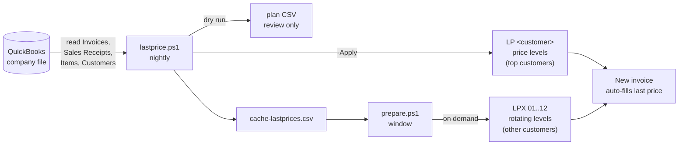

<div align="center">

# PriceRecall

**Auto-fill every customer's last sold price in QuickBooks Desktop invoices**


-2CA01C)
-5391FE)


</div>

---

## Table of contents

1. [The problem](#the-problem)
2. [The solution](#the-solution)
3. [How it works](#how-it-works)
4. [Requirements](#requirements)
5. [Installation](#installation)
6. [Usage](#usage)
7. [Daily workflow for the accountant](#daily-workflow-for-the-accountant)
8. [How discounts are detected](#how-discounts-are-detected)
9. [Output files](#output-files)
10. [Parameters](#parameters)
11. [Safety features](#safety-features)
12. [Scheduling the nightly run](#scheduling-the-nightly-run)
13. [Undo and recovery](#undo-and-recovery)
14. [Troubleshooting](#troubleshooting)
15. [Known limitations](#known-limitations)
16. [Repository layout](#repository-layout)

---

## The problem

QuickBooks Desktop has no "last price" feature. When the accountant creates an invoice, each line fills in the item's **default sales price**, not the price this specific customer paid last time. In a business where every customer has negotiated prices, staff have to look up old invoices by hand for every line. That is slow, and a single wrong price means a customer is over- or under-charged.

## The solution

PriceRecall reads your sales history through the official QuickBooks SDK and turns it into **QuickBooks Price Levels**, a feature QuickBooks already has:

- Every important customer gets a **personal per-item price level** named `LP <customer name>` holding the last price they paid for each item.
- That level is **linked to the customer**, so when you pick the customer on a new invoice, QuickBooks itself fills every item with that customer's last price. There is no add-on to open and nothing to copy.
- Customers outside the top list are served on demand from a small **"Prepare customer" window**, which loads their prices into one of 12 rotating levels in one click.
- The window also shows the customer's **last discount %** and copies `Discount 15%` to the clipboard, ready to paste into the invoice Memo.

Prices are stored **before discount** (the Rate on the invoice line). The discount is added as a separate Discount line, exactly as the accountant already does.

---

## How it works



### Step by step

1. **Read.** `lastprice.ps1` connects to the open company file and reads all Items, Customers and existing Price Levels. It then reads every Invoice and Sales Receipt from `-FromDate` (default `2021-01-01`) to today, **one month at a time** so large files don't time out.
2. **Compute.** For every *customer + item* pair it keeps the most recent sale line (by transaction date, then creation time, then line order). It records the unit price before discount, the net price after discount, the discount %, the previous price, how often the item was sold and the unit of measure.
3. **Rank.** QuickBooks 2011 allows a **maximum of 99 price levels** (the 100th fails with error 3180). The tool counts the levels you already use for other purposes, reserves 12 for the rotating `LPX` slots, and gives the remaining slots to the customers with the **highest net sales in the last 365 days**. The ranking is redone on every run, so the list follows your business as it changes.
4. **Plan.** Every customer and item gets an action: `NEW`, `CHANGE`, `SAME`, or a reason it is skipped. Everything goes into a plan CSV you can open in Excel.
5. **Apply** (only with `-Apply`). The tool:
   - unlinks and deletes `LP` levels of customers who **dropped out** of the top list (this frees slots first),
   - creates or updates the `LP` level for each top customer, adding new prices and never removing an existing item,
   - links the level to the customer.
6. **Prepare** (during the day). For a customer without a fixed level, the accountant picks the name in `prepare.bat`. The tool takes the least recently used `LPX` slot, clears it, fills it with this customer's last prices and links it. The next invoice for that customer fills automatically.

---

## Requirements

| Requirement | Details |
|---|---|
| Operating system | Windows (any version that runs QuickBooks Desktop) |
| QuickBooks | Desktop **Enterprise Solutions 11.0 (2011)**. The scripts use qbXML 10.0, so later Desktop versions should also work. |
| QuickBooks features | **Price Levels** enabled, with the *per item* type (Edit > Preferences > Sales & Customers) |
| QuickBooks SDK | `QBXMLRP2.RequestProcessor`, which is installed with QuickBooks Desktop |
| PowerShell | Windows PowerShell 5.1, **32-bit**: `C:\Windows\SysWOW64\WindowsPowerShell\v1.0\powershell.exe` (the `.bat` files already use it) |
| User | QuickBooks open on the company file, logged in as **Admin** for the first authorisation |

> **Why 32-bit?** The QuickBooks 2011 SDK is a 32-bit COM component. A 64-bit PowerShell cannot load it, and the script stops with a clear message if you try.

---

## Installation

1. **Download** this repository (green **Code** button > **Download ZIP**) and extract it to a folder, for example `C:\PriceRecall\`. Keep all files together.
2. **Set the company file path.** Open `apply-all.bat`, `apply-one.bat` and `prepare.bat` in Notepad and replace the path after `-AllowFile` with the **exact** path of your company file. To find it, press **F2** (or **Ctrl+1**) in QuickBooks and copy the *Location* field.
   ```bat
   -AllowFile "C:\Path\To\YourCompany.qbw"
   ```
3. **Authorise the tool once.** Open QuickBooks as Admin, then run in the 32-bit PowerShell:
   ```powershell
   C:\Windows\SysWOW64\WindowsPowerShell\v1.0\powershell.exe -ExecutionPolicy Bypass -File probe.ps1
   ```
   QuickBooks asks whether to allow **"Last Price Tool"** to access the file. Choose **"Yes, always; allow access even if QuickBooks is not running"** and confirm. `probe.ps1` only reads, and writes a short report to `Desktop\lastprice-probe.txt`.

> ⚠️ **Always test on a backup copy of the company file first**, and take a fresh QuickBooks backup before the first run on the live file.

---

## Usage

### 1. Dry run (no changes)

Double-click **`dryrun.bat`**.

The tool reads everything, builds the plan and writes it to `Desktop\LastPrice\plan-YYYYMMDD-HHMM.csv`. **Nothing is changed in QuickBooks.** Open the CSV in Excel and check a few customers you know well.

### 2. Try one customer

Edit the customer name after `-OnlyCustomer` in **`apply-one.bat`**, then run it. Type `YES` when asked. Only that customer is touched. Create a test invoice for the customer and check that the prices fill in.

### 3. Apply to all customers

Run **`apply-all.bat`** and type `YES`. On the first run this creates up to ~84 `LP` levels. Later runs only send what changed.

### 4. Prepare a customer without a fixed level

Run **`prepare.bat`**. A small window opens:

- Type part of the name in the search box. Customers marked **`[automatic]`** already have a fixed level, so you can go straight to the invoice.
- Select the customer and click **Prepare** (or double-click).
- The status line shows `READY: '<customer>' -> LPX 03 (57 items). Open a new invoice now.`
- If the customer had a discount last time, `Discount 15%` is **already on the clipboard**. Paste it into the invoice Memo with **Ctrl+V** and add the Discount line.

---

## Daily workflow for the accountant

| When | What | Who |
|---|---|---|
| Every night | `apply-all.bat` refreshes all `LP` levels and the cache | Scheduled (see below) |
| Before an invoice for a big customer | Nothing. Just open the invoice. | Accountant |
| Before an invoice for any other customer | Open `prepare.bat`, pick the customer, click **Prepare** | Accountant |
| On the invoice | Paste `Discount xx%` into the Memo (Ctrl+V) and add the Discount line | Accountant |
| Price lookup without invoicing | Open `Desktop\LastPrice\last-prices.csv` in Excel and filter by customer | Anyone |

---

## How discounts are detected

Discounts in QuickBooks are separate lines, so the tool has to work out which sale lines each discount line applies to. These rules were checked against real invoices:

| Discount line type | What it applies to |
|---|---|
| **Percentage** discount item (e.g. `-10%`) | The line directly above it, or all lines covered by a **Subtotal** directly above it. This is QuickBooks' own rule. |
| **One fixed-amount** discount line | Either the whole invoice or only the lines above it. The tool picks whichever gives a "round" percentage (e.g. 15% or 12.5%). |
| **Several fixed-amount** lines | Each covers the lines since the previous discount line. |

Staff often type a rounded amount, so a near-round result such as **14.96% or 14.999% is snapped to 15%** (and 12.47% to 12.5%), within 0.06 percentage points.

Discounts combine: a 10% line discount followed by a 5% invoice discount gives an effective 14.5%.

---

## Output files

Everything is written to **`Desktop\LastPrice\`**. These files contain customer prices, so they are **excluded from Git** by `.gitignore`.

| File | Written by | Contents |
|---|---|---|
| `plan-YYYYMMDD-HHMM.csv` | every run | Full plan: customer, status, price level, action, item, unit of measure, last price, net price, discount %, date, document number, previous price, times sold |
| `last-prices.csv` | full runs | Lookup list for every active customer, including those without a level (`AutoInInvoice = YES/blank`) |
| `cache-lastprices.csv` | full runs | Data used by the `prepare` window |
| `run-YYYYMMDD-HHMM.txt` | every run | Log of what was read, planned and written |
| `backup-levels-*.csv` | `-Apply` | Every `LP` level price **before** the change |
| `backup-customer-links-*.csv` | `-Apply` | Which customer was linked to which level **before** the change |
| `prepare-log.txt` | `prepare` | Every customer prepared and any error |

---

## Parameters

### `lastprice.ps1`

| Parameter | Default | Meaning |
|---|---|---|
| `-Apply` | off | Write to QuickBooks. Without it the run is a dry run. |
| `-AllowFile` | *(empty)* | Exact path of the company file allowed to be written. Required with `-Apply`. |
| `-OnlyCustomer` | *(empty)* | Process only this customer (full name). Never touches other customers. |
| `-FromDate` | `2021-01-01` | Read sales from this date (`yyyy-MM-dd`) |
| `-ActiveDays` | `365` | A customer needs a sale in this many days to get a fixed level. Also the window used for ranking. |
| `-MaxLevels` | `99` | QuickBooks price level limit |
| `-Rotating` | `12` | Number of `LPX` slots reserved for `prepare` |
| `-ExcludeCustomers` | `Cash Van`, `Cash Sales`, `Samples Marketing` | Generic customers that never get a level |
| `-NetPrice` | off | Old mode: store the price **after** discount instead of before |

### `prepare.ps1`

| Parameter | Default | Meaning |
|---|---|---|
| `-AllowFile` | *(empty)* | Refuse to write if another company file is open |
| `-Rotating` | `12` | Number of `LPX` slots (must match `lastprice.ps1`) |

---

## Safety features

- **Dry run by default.** Nothing is written unless you pass `-Apply`.
- **File lock.** With `-Apply`, the open company file must match `-AllowFile` exactly, or nothing is written.
- **Explicit confirmation.** The tool asks you to type `YES` before writing.
- **Your own price levels are never touched.** Customers who already have a price level that does not start with `LP ` or `LPX ` are skipped.
- **Prices are never removed.** Updating a level adds and changes prices but never deletes an item from it.
- **Backups before every write**, with the previous prices and customer links saved to CSV.
- **Limit check.** If the result would exceed 99 levels, the run stops before writing.
- **Inactive items and customers are skipped**, and so are generic cash customers.

---

## Scheduling the nightly run

Use **Windows Task Scheduler** on the PC that keeps QuickBooks open on the company file:

1. *Create Task* > **Triggers**: Daily, e.g. 02:00.
2. **Actions**: Start a program
   - Program: `C:\Windows\SysWOW64\WindowsPowerShell\v1.0\powershell.exe`
   - Arguments: `-ExecutionPolicy Bypass -File "C:\PriceRecall\lastprice.ps1" -Apply -AllowFile "C:\Path\To\YourCompany.qbw"`
3. **General**: *Run only when user is logged on* (QuickBooks must be open in the same session).

> **Note:** the script asks for `YES` before writing, which is intended for manual runs. For an unattended nightly task, that prompt must be answered automatically or removed for scheduled runs. Test the scheduled task once while watching it.

QuickBooks must be open, and no one should be editing a customer or a price level at that moment.

---

## Undo and recovery

- **Restore a QuickBooks backup.** This is the cleanest option and the reason to back up before the first live run.
- **Remove everything the tool created.** Delete the price levels whose names start with `LP ` and `LPX ` (Lists > Price Level List). QuickBooks clears the link on the customers automatically.
- **Restore old prices.** The `backup-levels-*.csv` and `backup-customer-links-*.csv` files record the state before each run.

---

## Troubleshooting

| Message / symptom | Cause | Fix |
|---|---|---|
| `ERROR: run with 32-bit PowerShell` | Started from the normal 64-bit PowerShell | Use the `.bat` files or the `SysWOW64` path |
| `Could not start QuickBooks` / access denied | Tool not authorised, or QuickBooks not open | Open QuickBooks as Admin and run `probe.ps1` again. Check *Edit > Preferences > Integrated Applications*. |
| `STOP: -AllowFile does not match` | Another company file is open, or the path differs | Copy the exact *Location* from F2 into the `.bat` file |
| Error **3180** when adding a level | The 99-level limit was reached | Delete unused price levels or lower `-Rotating` |
| `could not write last-prices.csv` | The file is open in Excel | Close Excel and run again |
| `Missing ...cache-lastprices.csv` in prepare | The nightly run has not run yet on this PC | Run `dryrun.bat` or `apply-all.bat` once |
| Invoice doesn't fill the last price | Customer not linked, or the item was not sold to them before | Run `prepare` for the customer and check the *Price Level* field on the customer |
| `SKIP: already has price level '...'` in the plan | The customer uses one of your own levels | Intended. Clear it on the customer if you want the tool to manage them. |

---

## Known limitations

- **99 price levels** in QuickBooks 2011, which is why only the top customers get a fixed level and the rest use the 12 rotating slots.
- **One price per item per level.** If a customer buys the same item in different units of measure, the plan marks `MixedUM = YES` and the price of the most recent unit is used.
- **Discounts are not filled automatically.** QuickBooks price levels hold prices only. The discount % is shown and copied for the accountant.
- **Level names** are limited to 31 characters, so long customer names are shortened (and `~2`, `~3` is added if two names collide).
- The prices are as fresh as the **last nightly run**. Prepare uses the same nightly cache.

---

## Repository layout

```
PriceRecall/
├── lastprice.ps1   Main engine: read, compute, plan, apply
├── prepare.ps1     "Prepare customer" window (rotating LPX levels)
├── probe.ps1       Read-only connection test and first authorisation
├── dryrun.bat      Dry run, writes the plan only
├── apply-one.bat   Apply for one customer (testing)
├── apply-all.bat   Apply for all customers (nightly)
├── prepare.bat     Opens the prepare window (no console)
├── .gitignore      Keeps customer data out of Git
└── README.md
```

> 🔒 **Never commit** the `LastPrice` folder, CSV or Excel exports, or company files (`.qbw`, `.qbb`). They contain customer prices. The `.gitignore` blocks them, but check before you push.

